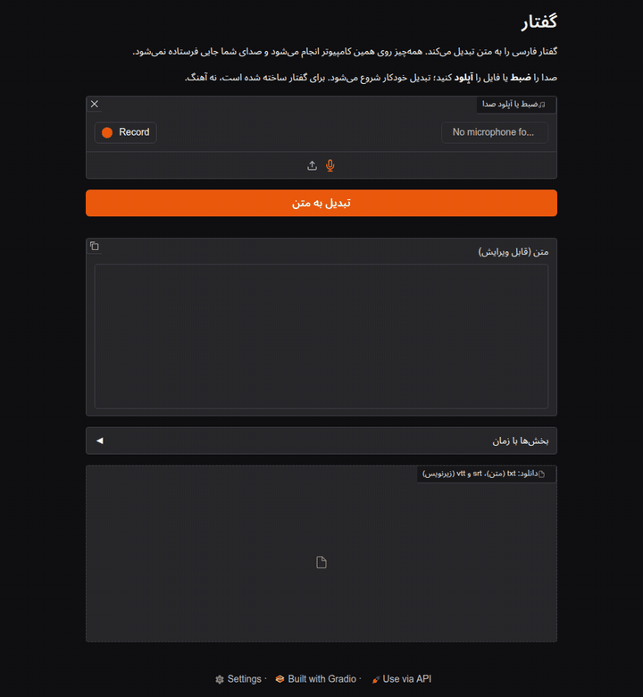
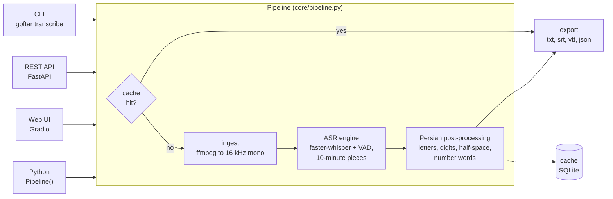

# Goftar (گفتار)

[](https://github.com/sepideafshoon3/goftar/actions/workflows/ci.yml)
[](LICENSE)

**Offline, free Persian speech-to-text.** Drop in a voice note or a long recording, get clean
Persian text, subtitles or JSON. Everything runs on your own machine: no cloud, no API keys,
no data leaving the laptop.



<sub>Demo audio: 16 seconds of the spoken Persian Wikipedia article
[«نوروز»](https://commons.wikimedia.org/wiki/File:Nowruz-fa.ogg), CC BY-SA 3.0. The text is
the model's unedited output, mistakes included.</sub>

- **Runs on an ordinary laptop**: a 74-minute podcast takes about 7 minutes on a 4 GB GPU, with
  under 2 GB of RAM.
- **Persian-aware post-processing**: Arabic letter variants, digits, half-spaces (ZWNJ),
  number words to digits, punctuation.
- **Four interfaces** on one core: CLI (batch), REST API (async jobs), web UI, Python library.
- **Readable subtitles**: SRT/VTT with at most two lines of about 42 characters per cue.
- **Measured, not guessed**: built-in benchmark (WER / CER / speed / RAM) on your own audio.
- **Fully offline**: download a model once, then `offline: true` guarantees no network access.
- **Cached**: the same file with the same settings is never transcribed twice.

## Quick start

Needs [Miniconda or Miniforge](https://github.com/conda-forge/miniforge) and about 4 GB of free
disk (2.5 GB for the environment, 1.6 GB for the model; 2 GB more with `--gpu`).

```bash
git clone https://github.com/sepideafshoon3/goftar && cd goftar
./scripts/setup.sh            # conda env "goftar" + git hooks; add --gpu on NVIDIA machines
conda activate goftar

goftar doctor                 # checks ffmpeg, GPU, models
goftar models download large-v3-turbo  # one-time 1.6 GB download (needs internet)
goftar transcribe voice.ogg --offline -f txt,srt
```

```bash
goftar transcribe ~/voices -r -o out/ -f txt,srt    # whole folder, recursive
goftar serve                                        # REST API on http://127.0.0.1:8000/docs
goftar ui                                           # web UI on http://127.0.0.1:7860
goftar bench bench/dataset --models medium,large-v3-turbo   # WER / CER / RTF / RAM table
```

```python
from goftar import Pipeline, Config

result = Pipeline(Config()).transcribe("voice.ogg")  # large-v3-turbo, GPU if available
print(result.text)
for seg in result.segments:
    print(f"{seg.start:7.1f}s  {seg.text}")
```

### With Docker

No conda needed. The model is not in the image: it is downloaded once into a volume on the
first start (about 1.6 GB), and every start after that runs with `--offline`.

```bash
docker build -t goftar .                                   # CPU image
docker run --rm -p 7860:7860 -v goftar-models:/data/models -v goftar-cache:/data/cache goftar
# web UI on http://127.0.0.1:7860

docker build -t goftar:gpu --build-arg GPU=1 .             # NVIDIA GPU image
docker run --rm --gpus all -p 7860:7860 -v goftar-models:/data/models goftar:gpu

docker run --rm -p 8000:8000 -v goftar-models:/data/models goftar serve --host 0.0.0.0
docker run --rm -v goftar-models:/data/models -v "$PWD:/work" goftar \
  transcribe /work/voice.ogg -o /work -f txt,srt
```

The GPU image needs the [NVIDIA Container Toolkit](https://docs.nvidia.com/datacenter/cloud-native/container-toolkit/latest/install-guide.html).
Set `-e GOFTAR_MODEL=medium` to use another model. The build only sends `src/`,
`pyproject.toml`, the README and the license to Docker (see `.dockerignore`), so recordings in
the repo folder never end up in an image.

`device` and `compute_type` default to `auto`: `cuda` + `int8_float16` when an NVIDIA GPU is
visible, otherwise `cpu` + `int8`. Something not working? See
[Common problems](docs/troubleshooting.md) (proxies, disk space, CUDA, microphone).

## Benchmarks

Word error rate (WER, lower is better) on Persian voice notes with hand-checked transcripts.
The **held-out** set was never used to tune prompts, rules or references, so it is the honest
number. Machine: laptop with an RTX 2050 (4 GB), i5-11400H, 16 GB RAM.

| Model | WER main (20 notes) | WER held-out (8 clips) | Speed (RTF) | RAM | Subtitle timing |
|---|---|---|---|---|---|
| **`large-v3-turbo`** (default) | 19.8% | 26.9% | 0.09 | 1.5 GB | yes |
| `large-v3-turbo` on CPU only | PLACEHOLDER_CPU_MAIN | PLACEHOLDER_CPU_HELD | PLACEHOLDER_CPU_RTF | PLACEHOLDER_CPU_RAM | yes |
| [MohammadGholizadeh/…-turbo-persian](https://huggingface.co/MohammadGholizadeh/whisper-large-v3-turbo-persian) | 14.3% | **23.0%** | 0.09 | 0.8 GB | no (30 s segments) |
| [givia/…-turbo-persian](https://huggingface.co/givia/whisper-large-v3-turbo-persian) | **13.6%** | 27.1% | 0.09 | 0.8 GB | no (30 s segments) |
| [AmirMohseni/…-large-v3-persian](https://huggingface.co/AmirMohseni/whisper-large-v3-persian-ct2-int8) | 15.8% | 37.1% | 0.20 | 1.0 GB | yes |

- RTF = processing time / audio length: 0.09 means one minute of audio takes about 5 seconds.
- With the older scoring (v1), `medium` scored 21.9% and `small` 52.0% on the main set.
- Changing decoding settings (beam size, VAD, prompts) did not beat the defaults on both sets.
  An `initial_prompt` helped on the set it was written for and hurt on the held-out set.

Full tables and method: [`bench/results-phase2.md`](bench/results-phase2.md) and
[ADR 3](docs/adr/0003-default-model-large-v3-turbo.md). Twenty-eight clips is a small set:
run `goftar bench` on your own recordings before choosing.

### Choosing a model

| Hardware | Model | `device` | `compute_type` |
|---|---|---|---|
| NVIDIA, 4 GB VRAM (default) | `large-v3-turbo` | `cuda` | `int8_float16` |
| NVIDIA, 8 GB+ VRAM | `large-v3-turbo` / `large-v3` | `cuda` | `float16` |
| CPU only | `large-v3-turbo` / `medium` | `cpu` | `int8` |
| Quick smoke test only | `small` (52% WER on Persian) | any | `auto` |

### Persian fine-tunes

Turbo-based Persian fine-tunes are more accurate on text (see the table) but return one segment
per 30 seconds, so use them for `.txt` output, not subtitles. They ship as Transformers weights;
convert them once to CTranslate2 (needs `transformers` and `torch`, about 5 GB of free RAM,
3.2 GB download):

```bash
hf download MohammadGholizadeh/whisper-large-v3-turbo-persian --local-dir /tmp/mg-hf
# this repo has no preprocessor_config.json; the base model's works (128 mel bins)
hf download openai/whisper-large-v3-turbo preprocessor_config.json --local-dir /tmp/mg-hf
python - <<'PY'
import ctranslate2
ctranslate2.converters.TransformersConverter(
    "/tmp/mg-hf", copy_files=["tokenizer.json", "preprocessor_config.json"],
    load_as_float16=True,  # loads 1.6 GB instead of 3.2 GB; only in the Python API, not the CLI
).convert("models/mg-turbo-fa", quantization="int8_float16")
PY
goftar transcribe voice.ogg --model models/mg-turbo-fa
```

The fine-tunes write numbers as words; `postprocess.number_words` (on by default) turns them
into digits.

## Architecture



Interfaces hold no logic: they build a `Config`, call `Pipeline`, and render the result. Engines
sit behind a one-class interface (`ASREngine`), so another backend can be added without touching
the rest. Details in [docs/architecture.md](docs/architecture.md) and the decision records in
[docs/adr](docs/adr).

## Configuration

Copy [`config/default.yaml`](config/default.yaml) to `goftar.yaml` (or use `--config`). Unknown keys
are rejected, so typos fail loudly. CLI flags override the file.

## Text conventions and optional spelling stage

- Foreign (English) words are written in Persian script: `گیت‌هاب`, not `GitHub`.
- Colloquial speech is kept as spoken (`میخوام`, `نمیدونم`), not rewritten as formal text.
- Compound number words become digits (`صد و بیست و پنج` → `۱۲۵`); single words such as `یه` or
  `دو` stay words, because they are often not numbers in speech.
- Scoring (v2) ignores spacing around `ها / تر / ی / می`, so `کتاب ها`, `کتابها` and `کتاب‌ها` count as the same word.
- Optional, off by default: `postprocess.spelling` fixes homophone-letter typos (ز/ذ/ض/ظ, س/ص/ث ...) using a word list, and `postprocess.glossary` applies your own mapping (see `config/glossary.example.yaml`). Try it with `goftar fix-text "..." --spelling` and keep it only if `goftar bench` improves on a held-out set.

## REST API

| Endpoint | Purpose |
|---|---|
| `GET /health` | status, version, active model |
| `POST /transcribe?format=json\|txt\|srt\|vtt` | upload a file, get the result synchronously |
| `POST /jobs` then `GET /jobs/{id}` | queue long files and poll |

```bash
curl -F "file=@voice.ogg" http://127.0.0.1:8000/transcribe
```

The server binds to `127.0.0.1` by default. There is no authentication: do not expose it
to a network without a reverse proxy that adds it.

## Privacy

With `offline: true` (or `--offline`) Goftar makes no network connections: HuggingFace is set
to offline mode, and the telemetry of onnxruntime (used by the voice-activity filter) is turned
off. This was checked by tracing every `connect` call during long transcriptions. The
web UI and the API listen on `127.0.0.1` only. How to check it yourself:
[Common problems](docs/troubleshooting.md#downloads-and-proxies).

## Development

```bash
make lint    # ruff
make test    # pytest (no model download needed: tests use a fake engine)
```

Branches are named `<type>/<kebab-description>` and commits follow
[Conventional Commits](https://www.conventionalcommits.org/); git hooks and CI enforce both.
Details in [CONTRIBUTING.md](CONTRIBUTING.md).

## License

MIT. Whisper model weights are released by OpenAI under the MIT license. The fine-tuned models
listed above have their own licenses (MIT, CC BY 4.0, Apache-2.0): check the model page.
