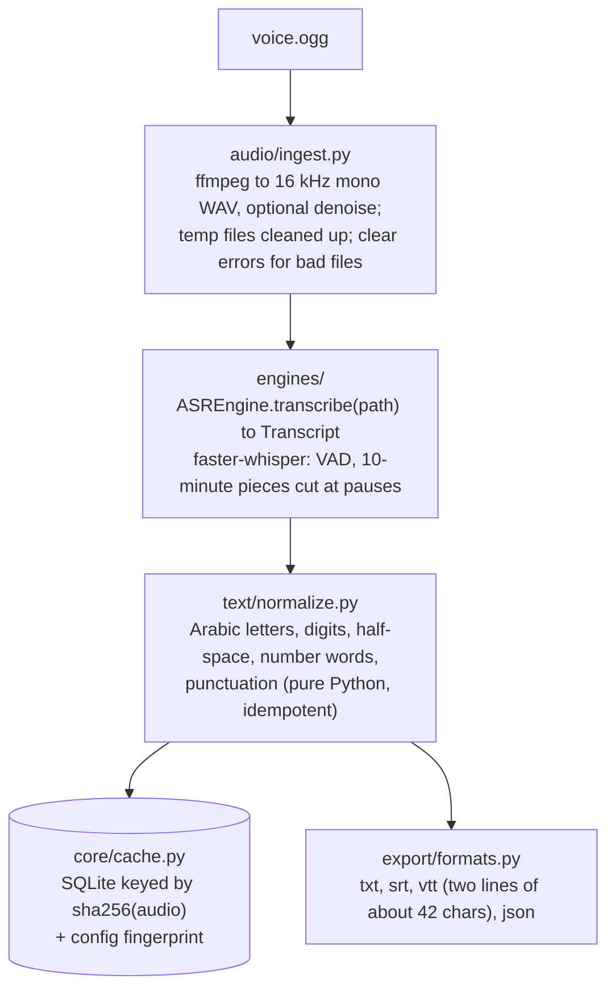

# Architecture

## Modules

| Module | Responsibility |
|---|---|
| `core/types.py` | `Segment`, `Transcript`: the only data structures that cross stage boundaries |
| `core/config.py` | typed config, YAML loading, strict validation, cache fingerprint |
| `core/pipeline.py` | orchestration; lazy engine; one lock so a single loaded model serves one job at a time |
| `engines/` | backend interface + registry; built-ins are imported lazily |
| `text/` | Persian normalisation, number words (`numbers.py`), optional spelling and glossary |
| `metrics.py`, `bench.py` | WER/CER and the benchmark harness |
| `interfaces/` | CLI (Typer), REST (FastAPI), UI (Gradio): thin layers over `Pipeline` |
| `live.py` | live microphone transcription: a pending window decoded quickly as tentative text, then committed on each pause (Gradio-free, so it is unit-tested) |
| `doctor.py` | environment diagnostics |

## Design rules

- Interfaces never contain logic; they build a `Config`, call `Pipeline`, render results.
- Heavy imports (faster-whisper, fastapi, gradio) are lazy, so `goftar version` and the test suite stay fast and work without them.
- Config is strict: unknown keys raise. The cache key hashes every setting that can change output, so changing the model or prompt never serves stale text.
- Offline is a first-class setting (`offline: true`), not an accident of having cached models.
  Importing `goftar` turns off onnxruntime's telemetry, which would otherwise contact Microsoft.
- Memory does not grow with file length: the engine decodes the audio once and transcribes it
  in 10-minute pieces cut at the quietest point near each boundary (about 2 GB peak RAM for a
  74-minute file).
- A batch never stops on a bad file, but it stops at once on an engine error (such as a missing
  model), which would fail for every file. Output names mirror the input folders, so two
  `voice.ogg` files in different folders never overwrite each other.
- Results can stream. An engine may accept `on_segment` and call it with each segment as soon
  as it has one; the pipeline cleans each segment with the same post-processing as the final
  result, so what the UI shows while working equals the final text. Engines without
  `on_segment` still work: their segments are handed over at the end.
- Live audio never touches the disk. `ASREngine.transcribe_samples()` takes 16 kHz samples held
  in memory, and `live.py` keeps each window under 12 seconds (Whisper reads at most 30), cuts
  at the quietest moment, and skips silence so the model cannot invent text for it.
